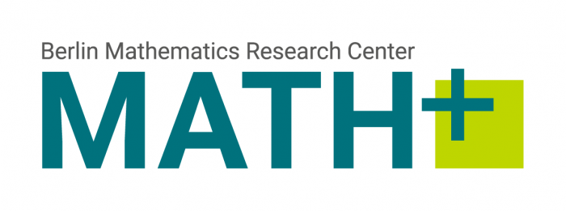

The Lemmata Repository is an experimental mathematics repository: each entry is a result
written for people and formalized in Lean 4 on Mathlib, and every formal statement is
checked by Lean's kernel before it is published. See [what "checked" means](checked.md)
and the [changelog](changelog.md) for how the site has developed.

The repository is born out of the Agentic AI for Mathematics (EF-LiOpt-3) project at the Berlin Mathematics Research Center MATH$^+$ (EXC-2046/2, project ID 390685689), funded by the Deutsche Forschungsgemeinschaft (DFG, German Research Foundation) under Germany's Excellence Strategy. In its initial phases it is maintained by the [IOL lab](https://iol.zib.de) at the Zuse Institute
Berlin (ZIB) and TU Berlin with the aim to transition to a community driven model in the very near future. 

## Contributing

Anyone can contribute. An entry is published once its pull request has been reviewed and
merged, and the site has built it and checked every formal statement.

```{include} _generated/contributing-body.md
```

By default an entry, prose and Lean alike, is published under the
[Creative Commons Attribution 4.0 International license (CC BY 4.0)](https://creativecommons.org/licenses/by/4.0/).
A contribution may specify another license, as long as it is compatible with the aim of the
repository: entries must remain freely readable, reusable and buildable upon. Currently
accepted besides the default are [CC BY-SA 4.0](https://creativecommons.org/licenses/by-sa/4.0/)
and [CC0 1.0](https://creativecommons.org/publicdomain/zero/1.0/). Each entry shows its
license under its title. Please contribute only material you have the right to license in
this way.

## Removal of contributions

Like arXiv, the repository is a permanent record. Once an entry has been published and
received its identifier, it is not removed: others may cite it, and other entries may build
on its Lean code, which would stop compiling if it disappeared. An entry can instead be
marked as **withdrawn**. It then stays available under its identifier, together with a
notice of the withdrawal and the reason given, and is no longer listed as a current entry.
Errors should be corrected by updating the entry; every published version remains
traceable through the entry's history.

Material can only be removed outright in exceptional cases, such as legal reasons or
copyright violations. Requests for removal or withdrawal go to the maintainers.

## Support

This platform has been partially supported by:

:::{div}
:class: lemmata-supporters

[](https://mathplus.de/)
[](https://www.zib.de/)
[](https://www.zib.de/)
:::
